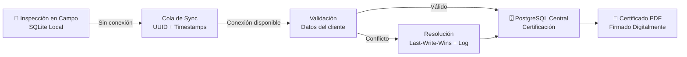
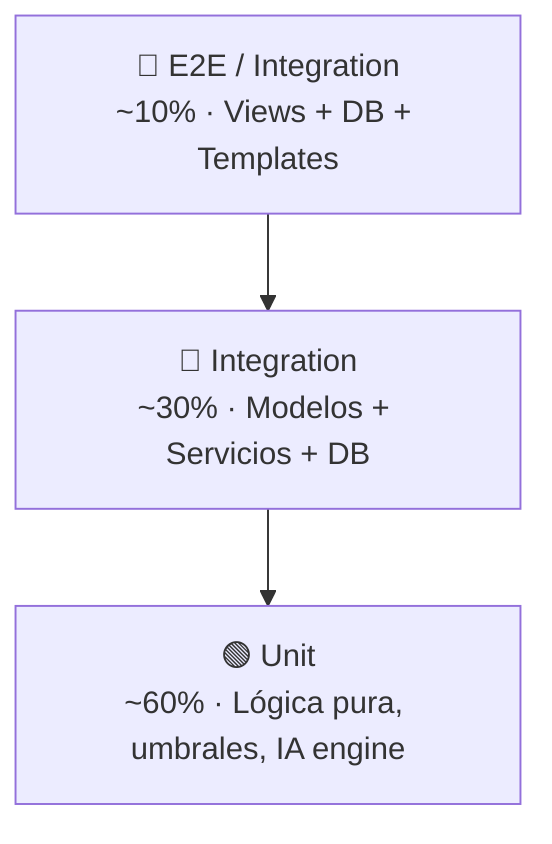

# ZenitCheck — Plan de Trabajo por Hitos

> **Aplicación Django para inspección de equipos de trabajo en alturas con visión artificial**

## Entorno Confirmado

| Componente | Versión | Notas |
|---|---|---|
| Python | 3.13.3 | Última estable |
| Django | 5.2.19 LTS | EOL abril 2028 |
| Pillow | 13.0.0 | Procesamiento de imágenes |
| Git | 2.56.1 | Control de versiones |
| Node.js | 22.15.0 | Build de assets front-end |
| OS | Windows | Desarrollo local |

## Decisiones Técnicas Clave

| Decisión | Elección | Justificación |
|---|---|---|
| **Framework CSS** | Tailwind CSS 3.x | Utility-first, mejor para móvil-primero, diseño limpio accesible |
| **IA / Visión** | PyTorch + torchvision (ResNet/EfficientNet fine-tunable) | Ecosistema maduro, modelos preentrenados, fácil de reemplazar, mejor comunidad para detección de anomalías |
| **PDF** | ReportLab + PyPDF2 | Generación programática con colores corporativos |
| **Firma digital** | python-pkcs11 / cryptography (X.509) | Estándar industrial |
| **BD offline** | SQLite (campo) → PostgreSQL (central) | Requisito explícito |
| **Sincronización** | Estrategia "last-write-wins" con UUID + timestamps + cola de sync | Resolución de conflictos documentada |
| **Testing** | pytest + pytest-django + pytest-cov + factory_boy + faker | Estándar industria, fixtures expresivos, cobertura medible |

---

## Hitos

### Hito 0 · Fundación del Proyecto ⏱ ~30 min
- [ ] Inicializar repositorio Git con `.gitignore`
- [ ] Crear entorno virtual, `requirements.txt` con versiones fijadas
- [ ] `django-admin startproject zenitcheck`
- [ ] Estructura de apps: `accounts`, `equipment`, `inspections`, `reports`, `ai_engine`, `sync`
- [ ] Settings split (base/dev/prod) con `.env`
- [ ] Configurar Tailwind CSS
- [ ] **Configurar pytest:** `pytest.ini` / `pyproject.toml`, `conftest.py` raíz, plugin `pytest-django`
- [ ] Primer commit + push a GitHub
- **Criterio de aceptación:** `python manage.py runserver` arranca sin errores; `pytest --co` descubre 0 tests sin errores

### Hito 1 · Modelos de Datos y Catálogo 🗄️ ~45 min
- [ ] Modelos: `Brand`, `EquipmentType`, `Equipment`, `Accessory`
- [ ] Campos: marca, modelo, tipo, serial, fecha fabricación, última inspección, vencimiento certificación
- [ ] Normas aplicables por tipo (ANSI Z359, EN 360/361/362/355/358)
- [ ] Migraciones + datos semilla (10+ marcas con info verificable)
- [ ] Admin Django personalizado
- [ ] 🧪 **Tests (pytest):**
  - `tests/equipment/test_models.py` — creación, validación de campos, `__str__`, unicidad de serial
  - `tests/equipment/test_factories.py` — factories con `factory_boy` para `Brand`, `Equipment`
  - `tests/equipment/test_seed.py` — comando de seed carga las 10+ marcas correctamente
- [ ] Commit + push
- **Criterio:** Admin funcional con catálogo cargado; `pytest tests/equipment/ -v` → 100% green

### Hito 2 · Autenticación y Roles 🔐 ~30 min
- [ ] Modelo de usuario extendido con roles: Inspector, Supervisor, Admin
- [ ] Login/logout con protección CSRF
- [ ] Permisos diferenciados por vista
- [ ] Decoradores y mixins de acceso por rol
- [ ] 🧪 **Tests (pytest):**
  - `tests/accounts/test_models.py` — creación de usuarios por rol, permisos asignados
  - `tests/accounts/test_auth.py` — login válido/inválido, redirección, CSRF
  - `tests/accounts/test_permissions.py` — acceso permitido/denegado según rol (inspector no ve admin, etc.)
- [ ] Commit + push
- **Criterio:** 3 usuarios de prueba con permisos diferenciados; `pytest tests/accounts/ -v` → 100% green

### Hito 3 · Captura de Fotos y Gestión de Imágenes 📷 ~45 min
- [ ] Modelo `InspectionPhoto` con relación a equipo
- [ ] Captura desde cámara del navegador (MediaDevices API)
- [ ] Subida manual de archivos
- [ ] Validación de tipo/tamaño
- [ ] Compresión con Pillow antes de guardar
- [ ] Vista previa en navegador
- [ ] Almacenamiento consistente SQLite/PostgreSQL
- [ ] 🧪 **Tests (pytest):**
  - `tests/inspections/test_photo_model.py` — relación foto↔equipo, campos requeridos
  - `tests/inspections/test_upload.py` — subida válida (JPEG/PNG), rechazo de tipos inválidos, límite de tamaño
  - `tests/inspections/test_compression.py` — imagen comprimida pesa menos que la original, mantiene formato
- [ ] Commit + push
- **Criterio:** Subir y previsualizar fotos desde móvil y escritorio; `pytest tests/inspections/ -v` → 100% green

### Hito 4 · Motor de IA para Detección de Anomalías 🤖 ~60 min
- [ ] Módulo `ai_engine` con interfaz reemplazable
- [ ] Modelo base: EfficientNet-B0 preentrenado + clasificador de anomalías
- [ ] Detección: costuras, decoloración, corrosión, desgaste, cortes, deshilachado, deformaciones
- [ ] Respuesta estructurada: tipo, bounding box, confianza
- [ ] Superposición visual de hallazgos sobre la imagen
- [ ] 🧪 **Tests (pytest):**
  - `tests/ai_engine/test_analyzer.py` — interfaz devuelve estructura correcta (tipo, bbox, confianza)
  - `tests/ai_engine/test_anomaly_types.py` — cada tipo de anomalía es detectado con imagen sintética
  - `tests/ai_engine/test_confidence.py` — confianza en rango [0.0, 1.0], valores extremos controlados
  - `tests/ai_engine/test_overlay.py` — superposición genera imagen válida con bounding boxes
  - `tests/ai_engine/test_interface.py` — el motor es reemplazable (mock analyzer pasa tests)
- [ ] Commit + push
- **Criterio:** Análisis de imagen demo con hallazgos visualizados; `pytest tests/ai_engine/ -v` → 100% green

### Hito 5 · Veredicto con Código de Color 🚦 ~30 min
- [ ] Lógica de umbrales explícita:
  - Verde Esmeralda `#16A34A`: 0 hallazgos críticos, confianza media < 30%
  - Ámbar `#EAB308`: hallazgos menores o próximo a vencer (< 30 días)
  - Rojo Carmesí `#DC2626`: cualquier hallazgo crítico con confianza > 70%
- [ ] Inspector confirma/modifica veredicto con justificación obligatoria
- [ ] Registro de auditoría (quién, cuándo, veredicto original vs final, justificación)
- [ ] Contraste WCAG AA validado (especialmente ámbar)
- [ ] 🧪 **Tests (pytest) — CRÍTICOS:**
  - `tests/inspections/test_verdict_thresholds.py` — parametrizados (`@pytest.mark.parametrize`):
    - Sin hallazgos → Verde
    - Hallazgo menor confianza < 70% → Ámbar
    - Hallazgo crítico confianza ≥ 70% → Rojo
    - Certificación vence en < 30 días, sin hallazgos → Ámbar
    - Certificación ya vencida → Rojo
    - Combinaciones de borde (hallazgo menor + vencimiento próximo)
  - `tests/inspections/test_verdict_colors.py` — códigos hex correctos por estado
  - `tests/inspections/test_verdict_audit.py` — modificación de veredicto genera entrada de auditoría con justificación
  - `tests/inspections/test_verdict_override.py` — inspector no puede confirmar sin justificación
- [ ] Commit + push
- **Criterio:** Veredictos asignados correctamente, auditoría registrada; `pytest tests/inspections/test_verdict* -v` → 100% green

### Hito 6 · Historial, Trazabilidad y Alertas 📋 ~30 min
- [ ] Vista de historial completo por equipo
- [ ] Timeline de inspecciones con fotos, hallazgos, veredictos
- [ ] Sistema de alertas de vencimiento de certificación
- [ ] Dashboard resumen para supervisor
- [ ] 🧪 **Tests (pytest):**
  - `tests/inspections/test_history.py` — historial ordenado cronológicamente, filtra por equipo
  - `tests/inspections/test_alerts.py` — alertas generadas para equipos próximos a vencer y vencidos
  - `tests/inspections/test_dashboard.py` — dashboard muestra conteos correctos por estado
- [ ] Commit + push
- **Criterio:** Historial navegable, alertas visibles; `pytest tests/inspections/test_history* tests/inspections/test_alerts* -v` → 100% green

### Hito 7 · Generación de PDF y Firma Digital 📄 ~45 min
- [ ] Plantilla PDF con colores corporativos
- [ ] Contenido: datos equipo, fotos, hallazgos, veredicto, inspector
- [ ] Firma digital X.509 del certificado
- [ ] Descarga y visualización del PDF
- [ ] 🧪 **Tests (pytest):**
  - `tests/reports/test_pdf_generation.py` — PDF generado es archivo válido, contiene datos del equipo
  - `tests/reports/test_pdf_colors.py` — colores de veredicto aplicados en el PDF
  - `tests/reports/test_digital_signature.py` — PDF firmado tiene firma válida verificable
  - `tests/reports/test_pdf_content.py` — PDF contiene: datos inspector, hallazgos, veredicto, fechas
- [ ] Commit + push
- **Criterio:** PDF generado con firma digital verificable; `pytest tests/reports/ -v` → 100% green

### Hito 8 · Sincronización Offline/Online 🔄 ~45 min
- [ ] Configuración dual SQLite (campo) / PostgreSQL (central)
- [ ] Cola de sincronización con UUIDs
- [ ] Estrategia de resolución de conflictos (last-write-wins con merge log)
- [ ] Sincronización de imágenes
- [ ] Validación de datos del cliente antes de certificar
- [ ] 🧪 **Tests (pytest):**
  - `tests/sync/test_queue.py` — entradas se encolan con UUID y timestamp
  - `tests/sync/test_conflict_resolution.py` — conflicto last-write-wins resuelve correctamente
  - `tests/sync/test_sync_flow.py` — datos offline se sincronizan a BD central (con mock PostgreSQL)
  - `tests/sync/test_image_sync.py` — imágenes locales se transfieren al storage central
- [ ] Commit + push
- **Criterio:** Datos creados offline se sincronizan al conectar; `pytest tests/sync/ -v` → 100% green

### Hito 9 · UI/UX Responsiva y Accesibilidad ♿ ~45 min
- [ ] Templates Tailwind responsivos (móvil-primero)
- [ ] Flujo de inspección usable con una mano en móvil
- [ ] Loading spinners y feedback durante análisis IA
- [ ] Validación WCAG AA en todos los estados de color
- [ ] Compatibilidad: Chrome, Firefox, Safari, Edge
- [ ] 🧪 **Tests (pytest):**
  - `tests/ui/test_views_status.py` — todas las vistas responden HTTP 200 para usuario autenticado
  - `tests/ui/test_forms.py` — formularios validan campos requeridos, rechazan datos inválidos
  - `tests/ui/test_wcag_colors.py` — contraste de cada color de veredicto cumple WCAG AA (ratio ≥ 4.5:1)
- [ ] Commit + push
- **Criterio:** Interfaz usable en móvil, contraste WCAG AA verificado; `pytest tests/ui/ -v` → 100% green

### Hito 10 · Tests Finales, Documentación y Deploy 🚀 ~30 min
- [ ] 🧪 **Suite completa de tests:**
  - Ejecución de suite completa: `pytest --cov=. --cov-report=html --cov-report=term -v`
  - Cobertura mínima objetivo: **80%** en módulos de negocio
  - Reporte HTML de cobertura en `htmlcov/`
  - Todos los tests parametrizados documentan el caso de borde
- [ ] README completo con:
  - Instalación y ejecución
  - Versiones del stack
  - Cómo ejecutar tests (`pytest`, con y sin cobertura)
  - Limitaciones de la IA
  - Normas aplicables por tipo de equipo
- [ ] Verificación final: app arranca, **tests pasan al 100%**, repo sincronizado
- [ ] Tag de versión v1.0.0
- [ ] Commit + push final
- **Criterio:** 100% operativo, documentado, en GitHub; `pytest` → 0 failures

---

## Normas de la Industria por Tipo de Equipo

| Tipo de Equipo | Norma Internacional | Norma US |
|---|---|---|
| Arneses de cuerpo completo | EN 361 | ANSI Z359.11 |
| Líneas de vida autorretráctiles | EN 360 | ANSI Z359.14 |
| Conectores / Mosquetones | EN 362 | ANSI Z359.12 |
| Absorbedores de energía | EN 355 | ANSI Z359.13 |
| Cinturones de posicionamiento | EN 358 | ANSI Z359.3 |
| Cuerdas de seguridad | EN 1891 | ANSI Z359.15 |
| Descensores | EN 341 | NFPA 1983 |
| Dispositivos anticaída | EN 353-1/2 | ANSI Z359.14 |

## Marcas del Catálogo Semilla

| # | Marca | Origen | Verificable | Notas |
|---|---|---|---|---|
| 1 | 3M (DBI-SALA, Protecta) | Internacional | ✅ | Líder global, adquirió Capital Safety |
| 2 | Petzl | Internacional | ✅ | Referente en equipos verticales |
| 3 | MSA Safety | Internacional | ✅ | Cotiza NYSE, 100+ años |
| 4 | Honeywell (Miller) | Internacional | ✅ | División Safety & Productivity |
| 5 | Guardian Fall Protection | Internacional | ✅ | Parte de SFS Group |
| 6 | SKYLOTEC | Internacional | ✅ | Alemana, ISO 9001 |
| 7 | Delta Plus | Internacional | ✅ | Francesa, cotiza Euronext |
| 8 | XP Safety | Nacional (CO) | ⚠️ **Pendiente** | Marca colombiana referenciada en mercado local |
| 9 | Arseg | Nacional (CO) | ✅ | Parte de Honeywell desde 2017 |
| 10 | Armadura | Nacional (CO) | ⚠️ **Pendiente** | Referenciada en mercado colombiano |

> **Nota:** **EPI** e **INSAFE** requieren confirmación adicional como marcas activas de equipos de altura en Colombia. Se incluyen como entradas editables marcadas "pendiente de verificación".

---

## Estrategia de Sincronización Offline/Online



---

## Estrategia de Testing con pytest 🧪

### Herramientas del Stack de Testing

| Paquete | Versión | Propósito |
|---|---|---|
| `pytest` | ≥8.x | Runner principal, fixtures, parametrize |
| `pytest-django` | ≥4.9 | Integración Django: `@pytest.mark.django_db`, client, settings |
| `pytest-cov` | ≥6.x | Cobertura de código con `coverage.py` |
| `factory_boy` | ≥3.3 | Factories para modelos Django (reemplazo de fixtures JSON) |
| `faker` | ≥30.x | Datos realistas de prueba (seriales, fechas, nombres) |
| `pytest-xdist` | ≥3.x | Ejecución paralela de tests (`-n auto`) |
| `freezegun` | ≥1.4 | Control de tiempo para tests de vencimiento y alertas |

### Pirámide de Tests



| Nivel | Qué cubre | Markers pytest | Ejemplo |
|---|---|---|---|
| **Unit** | Funciones puras, umbrales, lógica de negocio, motor IA | `@pytest.mark.unit` | `test_verdict_thresholds.py` |
| **Integration** | Modelos ↔ BD, factories, signals, management commands | `@pytest.mark.django_db` | `test_models.py`, `test_seed.py` |
| **E2E** | Vistas HTTP, formularios, permisos, flujo completo | `@pytest.mark.django_db` + `client` | `test_views_status.py` |

### Estructura de Directorios de Tests

```
tests/
├── conftest.py              # Fixtures globales, django settings
├── equipment/
│   ├── __init__.py
│   ├── conftest.py          # Factories de Brand, Equipment
│   ├── test_models.py
│   ├── test_factories.py
│   └── test_seed.py
├── accounts/
│   ├── __init__.py
│   ├── conftest.py          # Factories de User por rol
│   ├── test_models.py
│   ├── test_auth.py
│   └── test_permissions.py
├── inspections/
│   ├── __init__.py
│   ├── conftest.py          # Factories de Inspection, Photo
│   ├── test_photo_model.py
│   ├── test_upload.py
│   ├── test_compression.py
│   ├── test_verdict_thresholds.py   # ← CRÍTICO, parametrizado
│   ├── test_verdict_colors.py
│   ├── test_verdict_audit.py
│   ├── test_verdict_override.py
│   ├── test_history.py
│   ├── test_alerts.py
│   └── test_dashboard.py
├── ai_engine/
│   ├── __init__.py
│   ├── test_analyzer.py
│   ├── test_anomaly_types.py
│   ├── test_confidence.py
│   ├── test_overlay.py
│   └── test_interface.py
├── reports/
│   ├── __init__.py
│   ├── test_pdf_generation.py
│   ├── test_pdf_colors.py
│   ├── test_pdf_content.py
│   └── test_digital_signature.py
├── sync/
│   ├── __init__.py
│   ├── test_queue.py
│   ├── test_conflict_resolution.py
│   ├── test_sync_flow.py
│   └── test_image_sync.py
└── ui/
    ├── __init__.py
    ├── test_views_status.py
    ├── test_forms.py
    └── test_wcag_colors.py
```

### Configuración (en `pyproject.toml`)

```toml
[tool.pytest.ini_options]
DJANGO_SETTINGS_MODULE = "zenitcheck.settings.test"
python_files = ["test_*.py"]
python_classes = ["Test*"]
python_functions = ["test_*"]
addopts = "-v --strict-markers --tb=short"
markers = [
    "unit: Pruebas unitarias sin BD",
    "slow: Pruebas que tardan más de 2s (IA, PDF)",
    "e2e: Pruebas end-to-end de vistas",
]

[tool.coverage.run]
source = ["equipment", "accounts", "inspections", "reports", "ai_engine", "sync"]
omit = ["*/migrations/*", "*/tests/*", "manage.py"]

[tool.coverage.report]
fail_under = 80
show_missing = true
```

### Convenciones

- **Naming:** `test_<modulo>_<comportamiento>_<resultado_esperado>`
  Ejemplo: `test_verdict_critical_finding_above_70_returns_red`
- **AAA:** Arrange → Act → Assert en cada test
- **Fixtures:** `conftest.py` por directorio, compartidas arriba
- **Parametrize:** para umbrales, tipos de anomalía y casos de borde
- **No side effects:** cada test limpia su estado (`@pytest.mark.django_db(transaction=True)` si necesario)

### Métricas Objetivo

| Módulo | Cobertura mínima |
|---|---|
| `inspections` (veredictos) | **95%** |
| `ai_engine` | **85%** |
| `equipment` (modelos) | **90%** |
| `accounts` (auth/permisos) | **85%** |
| `reports` (PDF) | **80%** |
| `sync` | **80%** |
| **Global** | **≥ 80%** |

### Comandos de Ejecución

```bash
# Todos los tests
pytest

# Con cobertura y reporte HTML
pytest --cov=. --cov-report=html --cov-report=term

# Solo unitarios (rápidos)
pytest -m unit

# Solo un módulo
pytest tests/inspections/test_verdict_thresholds.py -v

# En paralelo
pytest -n auto

# Excluir tests lentos (IA)
pytest -m "not slow"
```
